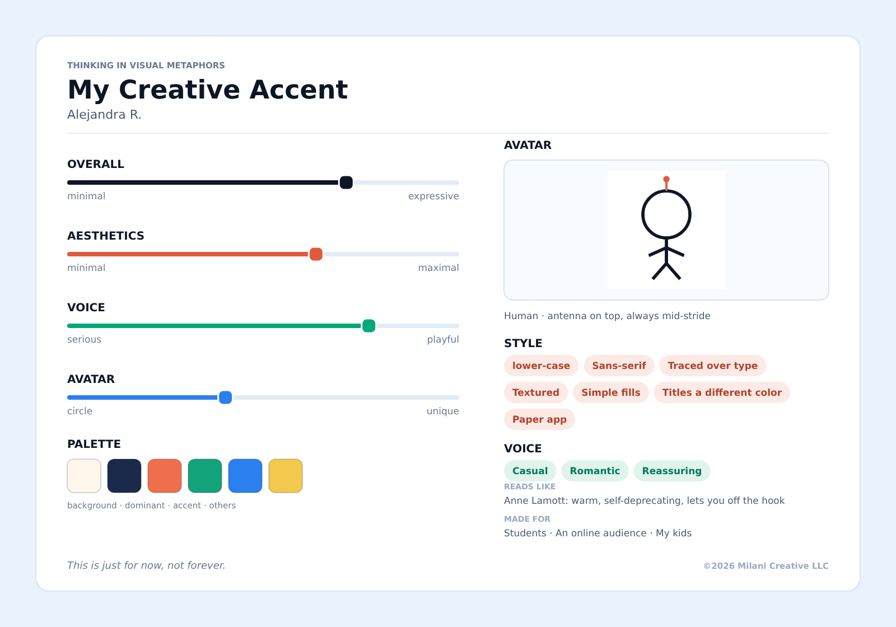

# Creative Accent Interpreter

Four dials to hear the style you already have. A browser version of the Creative Accent exercise from **Thinking in Visual Metaphors**.

Students walk four dials (Overall, Aesthetics, Voice, Avatar), make a handful of concrete choices, upload their avatar sketch, and download a PNG accent card they can pin above their desk.



---

## Putting it online

You need a free GitHub account. No coding, no command line, about five minutes.

**1. Make the repository**

Go to [github.com/new](https://github.com/new). Name it `creative-accent-interpreter`. Leave it **Public**, since free hosting requires it. Don't tick "Add a README file", because this folder already has one. Click **Create repository**.

**2. Upload the files**

On the new empty repo page, click **uploading an existing file**. Drag in *everything* from this folder, including the file called `.nojekyll` (it starts with a dot and may be hidden — on Mac press `Cmd + Shift + .` in Finder to show hidden files). Scroll down, click **Commit changes**.

**3. Switch on hosting**

Go to **Settings** (top of the repo) then **Pages** in the left sidebar. Under "Build and deployment", set **Source** to `Deploy from a branch`, **Branch** to `main`, and the folder to `/ (root)`. Click **Save**.

Wait a minute or two, then reload that page. Your link appears at the top:

```
https://YOUR-USERNAME.github.io/creative-accent-interpreter/
```

That's the link to give students. It works on phones, tablets and laptops.

**4. One small thing to finish**

Open `index.html` on GitHub, click the pencil icon, and find the two lines containing `USERNAME.github.io`. Replace `USERNAME` with your actual GitHub username in both. This only affects the preview image that appears when someone pastes the link into Slack, iMessage or a course platform. Everything else already works.

### Updating it later

Open any file in the repo, click the pencil icon, edit, and click **Commit changes**. The live site updates within a minute. To replace a file wholesale, delete it and upload the new version.

### If you'd rather use your own domain

Add a file named `CNAME` containing just your domain (for example `accent.milanicreative.art`), then point a CNAME record at `YOUR-USERNAME.github.io` with your domain registrar. GitHub's Pages settings will confirm when it takes effect.

---

## What students experience

Five screens: Overview, Aesthetics, Voice, Avatar, Card. A **See it all** button in the header flattens everything onto one scrolling page, which suits the live session when you say "three minutes, starting now."

Their answers save automatically in their own browser, so they can close the tab mid-session and come back to it. **Start over** clears everything.

Nothing they enter ever leaves their device. There is no server, no account, no analytics, and no network request of any kind once the page has loaded. Their avatar sketch is read locally and drawn straight onto the card. This matters because you're asking them to upload their own drawings, and you can tell them that without qualification.

On an iPhone or iPad they can add it to their home screen and it opens like an app.

---

## Changing the words

Every word a student reads lives in one file, `copy.js` — the dial readings, the button labels, the text printed on the downloadable card, even the pop-up messages.

**The quick way.** Open `copy.js`, find the line, change the text between the quote marks, save. Leave the part before the colon alone.

**The Word way.** `Creative Accent Interpreter - Copy.docx` contains all 199 strings in a two-column table. Edit the right column, then send it to whoever maintains the repo and they'll run one command to fold your edits back in. Conventions in the doc:

| You write | What happens |
|---|---|
| anything in the right column | replaces that string |
| `DELETE` | removes the string entirely |
| `NOTE:` and then a message | stripped out and shown to the maintainer, not shipped |

Rows flagged in red carry formatting tags or placeholders. Keep the marked parts as they are; the words around them are fair game.

See `CONTRIBUTING.md` for the commands.

---

## What's in this folder

**Needed for the site to run:**

```
index.html              the app
copy.js                 every word a student sees
icon.svg                favicon
icon-192.png            home-screen icons
icon-512.png
apple-touch-icon.png
og-image.png            preview image for shared links
site.webmanifest        lets it install to a home screen
.nojekyll               tells GitHub to serve the files as-is
```

**Documentation and tooling, safe to keep in the repo:**

```
README.md
LICENSE
CONTRIBUTING.md
preview.png                                sample output card
Creative Accent Interpreter - Copy.docx    all copy, editable in Word
make-copy-doc.js                           builds that doc from copy.js
apply-copy-doc.py                          reads the edited doc back in
verify.js                                  automated test of the whole flow
```

---

## How it was built

**Four dials.** Each slider maps to one of five written readings drawn from the live session. No number is shown; the sentence underneath is the feedback.

**Chosen by looking, not reading.** Wherever a choice is aesthetic, the option shows itself rather than naming itself. Case, family and source are type specimens. Audience is eight hand-drawn line icons. Fills are a flat disc against a gradient disc. Titles are a miniature mock of a title over two label lines, drawn live in the student's own palette from the swatches directly above. Texture is the same small drawing on grained paper against flat paper.

**The progress bar takes the color of the dial you're on:** ink, coral, green, blue.

**The card** is drawn on a canvas at 1600x1120 and downloaded as a PNG.

No frameworks, no build step, no dependencies. It's an HTML file and a text file.

---

## Possible next versions

- A fifth dial for **level of abstraction** (depiction, representation, interpretation). You call it "one last special dial" in the session, and a student asks directly how it relates to the accent.
- A **color scheme dial**, binary to full spectrum, ahead of picking specific colors.
- **Shading** as an aesthetics field.
- A **square card** export for students who want to post their accent.
- Draw-in-browser sketching as an alternative to uploading.
- A side-by-side "compare with a classmate" view for the feedback breakout.

---

## License

Copyright (c) 2026 Milani Creative LLC. All rights reserved. See [LICENSE](LICENSE).

Use it and share the link freely. Copying, rebranding or reusing the content in another course is not permitted.
